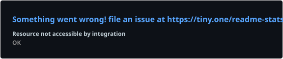

 <h2>
Hello World!
 </h2>

- 💻 Atualmente me aprofundando nas tecnologias .Net, AspNet Core e em todo ecossistema de Software.
- ⚙️ Desenvolvedor de Software.
- 📚 Ciência da Computação - FEI.
  

## Linguagens e ferramentas 

<!-- 

   
   
  
 

 -->

  
  
  
  
  
  
  
  
  
  
  
  
  
  
  

  
## Redes sociais

 
 
 
 
 

 
###

<!-- 

  
  

 -->

###

<picture data-importer="pacman">
  <source media="(prefers-color-scheme: dark)" srcset="https://raw.githubusercontent.com/GabrielMatoss/GabrielMatoss/pacman-output/bomberman-contribution-graph-dark.svg?game=bomberman">
  <source media="(prefers-color-scheme: light)" srcset="https://raw.githubusercontent.com/GabrielMatoss/GabrielMatoss/pacman-output/bomberman-contribution-graph.svg?game=bomberman">
  
</picture>

###

  

###

